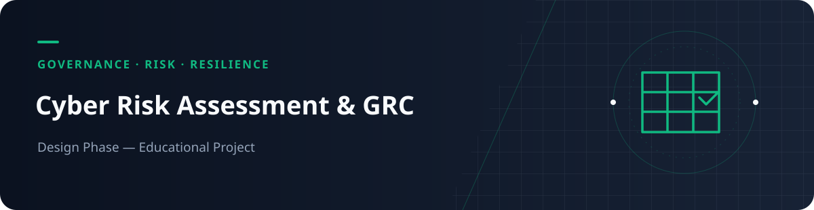
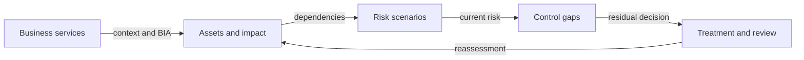

# Cyber Risk Assessment & GRC

**Design Phase — Educational Project**

Design a documented risk assessment for a fictional SME, from business impact and threat scenarios to accountable treatment and continuity objectives.

## Why this project

A control checklist cannot explain which risks deserve investment or who is accountable. A small business needs scored, traceable scenarios and evidence that controls work.

- Connect service dependencies and business impacts to risk scenarios.
- Compare inherent and residual risk with explicit assumptions and ownership.
- Map proposed treatments to control goals, evidence and decision records.

## Proposed system

Fictional SME: a 45-person service firm with an order portal, SaaS identity, employee endpoints, accounting service and an outsourced hosting provider. Map service owner, information class, supplier, upstream/downstream dependencies, backup, lifecycle and retained records. Keep assessors, risk owners, reviewers and approvers distinct, with restricted drafts and a reviewed educational export.

**Design trade-off.** Use ISO for management and controls, CSF for outcome communication and CIS for actionable safeguards. Example mappings convey intent and do not imply equivalence. Use EBIOS workshops for scenarios with meaningful threat and ecosystem dependencies. Keep inherent and residual scores separate since a planned control cannot reduce observed residual risk.

## Engineering stack

Use ISO/IEC 27001:2022 with Amendment 1:2024 as the ISMS reference, 27002:2022 for control guidance and 27005:2022 for risk management. NIST CSF 2.0 describes target outcomes. CIS Controls v8.1 offers prioritized safeguards. ANSSI EBIOS Risk Manager guide v1.5 (September 2024) supports structured scenario workshops. Maintain Markdown and a structured tabular register for low operating cost.

## Trust and technical challenges

- **Supplier outage** across provider to order portal. Recovery objectives, backups and dependency inventory.
- **Account takeover** across external users to saas identity. MFA, access reviews and incident escalation.
- **Ransomware impact** across endpoints to shared records. Segmentation and tested restore.
- **Bias or tampering** across assessor to approver. Versioned register, independent review and restricted approval.

## Lab and acceptance

A local editor, encrypted workspace and versioned tables are sufficient. Use fictional people, systems and evidence only. Access to full ISO texts, where required, depends on institutional or authorized licensing.

Future tabletop verifies completeness from context through ongoing monitoring. Require one owner and review date for each risk, an evidence plan for every proposed control, documented assumptions for scores, and approved residual decisions. Two reviewers independently score the same fictional scenarios and reconcile differences of more than one ordinal step. Exercise an outage and access incident with timed escalation and dependency logs. Verify RTO/RPO definitions through the continuity template and record remaining unknowns.

## Delivery and professional skills

Fictional enterprise context, BIA, asset inventory, risk register, control cross-reference, treatment plan, policy templates, audit report and continuity exercise.

Risk assessment, control mapping, ISMS literacy, executive communication and continuity evaluation.

Phase 0 design is documented. The [roadmap](ROADMAP.md) tracks four future stages, from a minimal prototype through validation and evidence publication.

## Scope and ethics

Use fictional information and authorized references. Preserve copyright on standards and label policy, risk, audit and continuity examples as educational.

## Design references and navigation

- [Architecture](docs/architecture.md) · [Technical design](docs/technical-design.md) · [Threat model](docs/threat-model.md)
- [Learning objectives](docs/learning-objectives.md) · [Testing strategy](docs/testing-strategy.md) · [Lab requirements](docs/lab-requirements.md)
- [Official references](docs/references.md) · [Evidence template](templates/risk-register.md) · [Security](SECURITY.md)
- [Back to the portfolio](https://github.com/Hrr-Yassin)

Additional templates include [assessment](templates/risk-assessment.md), [policy](templates/security-policy.md), [audit](templates/audit-report.md) and [continuity exercise](templates/continuity-exercise.md).
