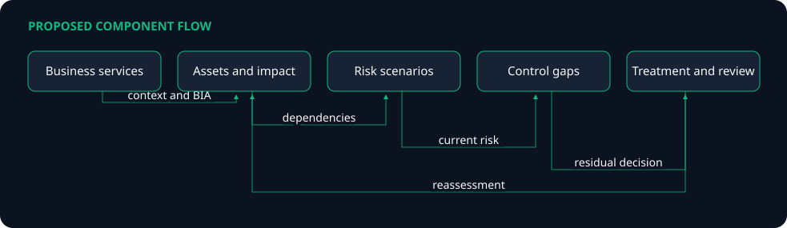

# Architecture

**Proposed topology**

Fictional SME: a 45-person service firm with an order portal, SaaS identity, employee endpoints, accounting service and an outsourced hosting provider. Map service owner, information class, supplier, upstream/downstream dependencies, backup, lifecycle and retained records. Keep assessors, risk owners, reviewers and approvers distinct, with restricted drafts and a reviewed educational export.

| Source | Destination | Interface or record |
| --- | --- | --- |
| Business services | Assets and impact | context and BIA |
| Assets and impact | Risk scenarios | dependencies |
| Risk scenarios | Control gaps | current risk |
| Control gaps | Treatment and review | residual decision |
| Treatment and review | Assets and impact | reassessment |

## Decision and limitation

Use ISO for management and controls, CSF for outcome communication and CIS for actionable safeguards. Example mappings convey intent and do not imply equivalence. Use EBIOS workshops for scenarios with meaningful threat and ecosystem dependencies. Keep inherent and residual scores separate since a planned control cannot reduce observed residual risk.

See [security boundaries](threat-model.md) and [deployment assumptions](lab-requirements.md).
